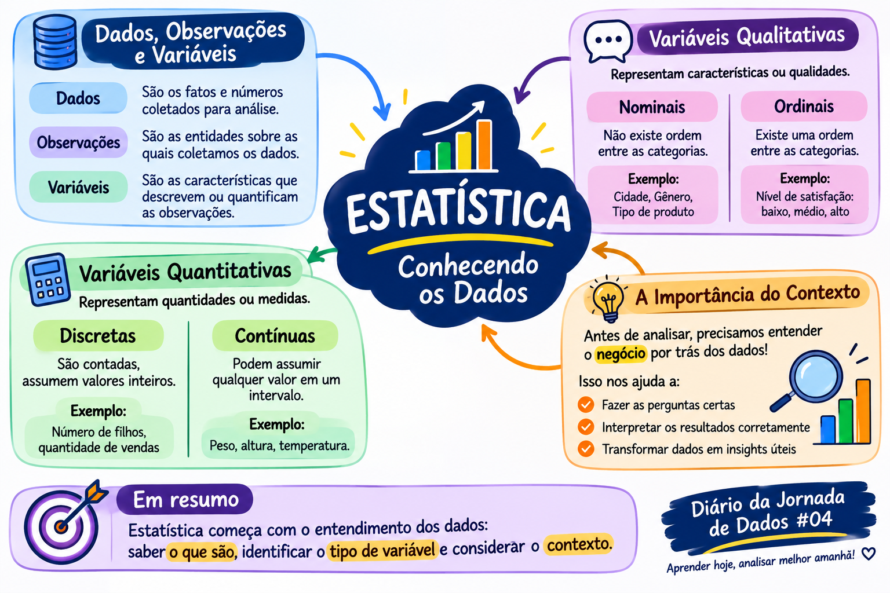

# Estatística: Conhecendo os Dados

## Introdução

Quando trabalhamos com análise de dados, é comum encontrar tabelas com diversas linhas, colunas e informações. Mas será que basta olhar para esses números para compreender o que eles representam?

<!-- more -->

Antes de iniciar uma análise, precisamos entender os dados, identificar suas características e compreender o contexto em que foram gerados.

Neste estudo, estou aprofundando alguns conceitos fundamentais da Estatística: dados, observações, variáveis e suas classificações.

## 1. Dados, observações e variáveis

Para começar, é importante compreender a diferença entre esses três conceitos.

**Dados**

São os valores ou informações coletados que podem ser utilizados em uma análise.

Exemplos:

- Nome de um cliente;
- Idade;
- Cidade;
- Valor de uma venda.

**Observações**

São os elementos ou entidades sobre os quais os dados são coletados.

Em uma tabela de clientes, por exemplo, cada linha pode representar uma observação, ou seja, um cliente.

**Variáveis**

São as características que descrevem ou quantificam as observações.

Na mesma tabela, podemos ter variáveis como nome, idade, cidade e renda.

### Exemplo prático

Imagine uma tabela de clientes:

| Nome | Idade | Cidade |
|---|---:|---|
| Ana | 28 | São Paulo |
| Carlos | 35 | Campinas |
| Marina | 42 | Santos |

Nesse exemplo:

- Cada linha representa uma observação (um cliente).
- Cada coluna representa uma variável.
- Cada valor preenchido na tabela representa um dado.

Essa distinção ajuda a compreender como as informações estão organizadas e o que cada elemento representa.

## 2. Classificação das variáveis

As variáveis podem ser classificadas em dois grandes grupos: qualitativas e quantitativas.

### 2.1 Variáveis qualitativas

Representam características, categorias ou qualidades. Não expressam uma quantidade numérica propriamente dita.

Elas podem ser divididas em:

**Nominais**

São categorias que não possuem uma ordem natural entre si.

Exemplos:

- Cidade;
- Marca de um produto;
- Tipo de combustível;
- Estado civil.

Não existe uma hierarquia entre essas categorias.

**Ordinais**

São categorias que possuem uma ordem ou classificação.

Exemplos:

- Nível de satisfação: baixo, médio e alto;
- Escolaridade;
- Classificação de atendimento: ruim, regular e bom.

Nesse caso, existe uma sequência entre as categorias.

### 2.2 Variáveis quantitativas

Representam quantidades que podem ser expressas numericamente.

São divididas em:

**Discretas**

Representam valores obtidos por contagem. Geralmente assumem valores inteiros.

Exemplos:

- Quantidade de vendas;
- Número de alunos;
- Quantidade de produtos vendidos;
- Número de filhos.

**Contínuas**

Representam medidas e podem assumir diferentes valores dentro de um intervalo, inclusive valores decimais.

Exemplos:

- Peso;
- Altura;
- Temperatura;
- Tempo de atendimento.

A diferença principal é que as variáveis discretas estão associadas à contagem, enquanto as contínuas estão associadas à medição.

## 3. Por que precisamos identificar os tipos de variáveis?

Identificar corretamente o tipo de variável é importante porque isso influencia a maneira como os dados serão analisados.

| Variável | Exemplo | Classificação |
|---|---|---|
| Nome | Ana | Qualitativa nominal |
| Idade | 16 | Quantitativa discreta |
| Estado | São Paulo | Qualitativa nominal |
| Renda | R$ 3.500,00 | Quantitativa contínua |
| Escolaridade | Ensino médio | Qualitativa ordinal |

Por exemplo:

- Uma variável nominal pode ser utilizada para agrupar clientes por cidade.
- Uma variável ordinal permite analisar níveis de satisfação.
- Uma variável discreta pode ajudar a calcular a quantidade de vendas.
- Uma variável contínua permite analisar medidas, como o valor médio de uma compra ou o tempo de atendimento.

Conhecer essas classificações ajuda a escolher formas adequadas de organizar, resumir e interpretar os dados.

## 4. A importância de entender o contexto do negócio

Um dos pontos mais importantes na análise de dados é compreender o negócio por trás das informações.

Não basta saber que determinada coluna representa uma venda ou que uma linha corresponde a um cliente. Precisamos entender o significado daquela informação dentro da realidade da empresa.

Algumas perguntas que ajudam nesse processo:

- O que a empresa vende ou oferece?
- Quem são seus clientes?
- Como funciona o processo de vendas?
- Em que momento uma venda é considerada concluída?
- O que significa uma venda cancelada?
- Qual problema a empresa deseja compreender ou resolver?

Imagine uma análise de vendas. Antes de calcular indicadores, precisamos entender como funciona o processo comercial, quais são as etapas e quais regras definem uma venda como concluída.

Sem esse contexto, podemos interpretar os números de maneira equivocada e chegar a conclusões que não representam a realidade do negócio.

**Entender o negócio é o que nos permite fazer as perguntas certas aos dados e transformar informações em análises que realmente façam sentido.**

## 5. O que ficou deste estudo?

Neste estudo, aprofundei conceitos que são fundamentais para quem trabalha com dados.

Aprendi a diferenciar dados, observações e variáveis, compreender a classificação das variáveis qualitativas e quantitativas e, principalmente, reforçar a importância de entender o contexto antes de iniciar uma análise.

Afinal, uma análise não começa simplesmente com uma consulta SQL, um gráfico ou um dashboard.

Ela começa com a compreensão do problema e do significado dos dados que temos em mãos.

**Não basta ter dados. Precisamos entender o que eles representam!**

## Mapa mental

[:material-download: Baixar o mapa mental](../../assets/images/mapa-mental-estatistica.png){ .md-button download="mapa-mental-estatistica.png" }
